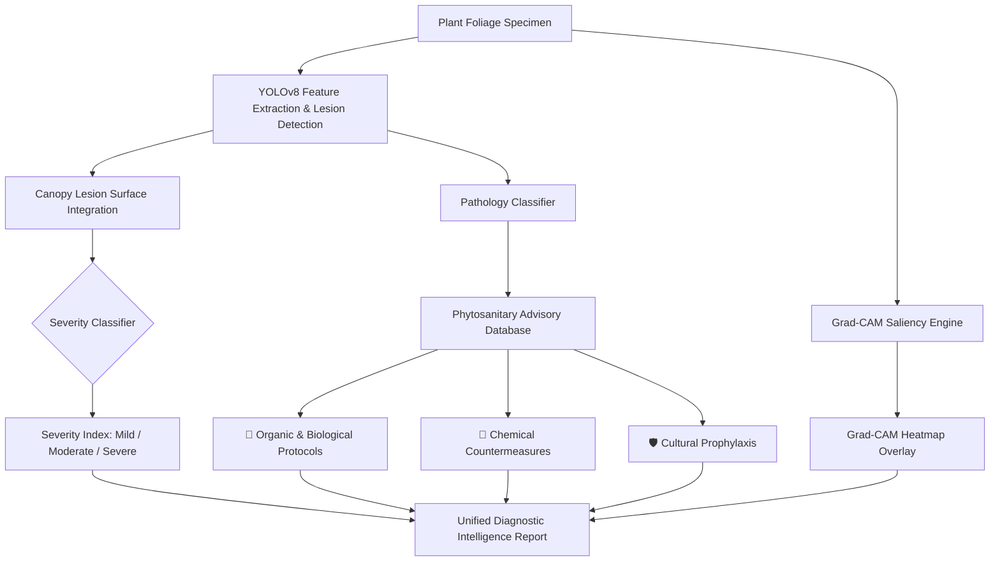

# 🌿 CropGuard AI — Edge Plant Disease Vision & Agronomic Advisory Engine

[](https://www.python.org/)
[](https://fastapi.tiangolo.com/)
[](https://github.com/ultralytics/ultralytics)
[](https://pytorch.org/)
[](LICENSE)

An edge-deployable crop pathology diagnostic platform powered by **YOLOv8 deep learning**, **Grad-CAM visual explainability**, **canopy severity index calculation**, and an **agronomic prescriptive remediation engine**.

Built for precision agriculture, agronomists, greenhouse operators, and field farmers to detect foliar crop diseases early and receive actionable organic, chemical, and cultural countermeasures.

---

## 📑 Table of Contents

- [System Architecture](#-system-architecture)
- [Key Features](#-key-features)
- [Supported Crops & Pathologies (18 Classes)](#-supported-crops--pathologies-18-classes)
- [Quickstart & Installation](#-quickstart--installation)
- [Web Diagnostic Studio](#-web-diagnostic-studio)
- [REST API Reference](#-rest-api-reference)
- [About the PlantVillage Dataset](#-about-the-plantvillage-dataset)
- [Model Training & Edge ONNX Export](#-model-training--edge-onnx-export)
- [Automated Verification Suite](#-automated-verification-suite)
- [Deploy to GitHub Pages (Serverless Web Studio)](#-deploy-to-github-pages-serverless-web-studio)
- [Always-On 24/7 Cloud Backend (Docker & Render)](#-always-on-247-cloud-backend-docker--render)
- [Directory Structure](#-directory-structure)
- [License](#-license)

---

## 🏗️ System Architecture



---

## 🚀 Key Features

* **Real-Time Lesion Detection:** YOLOv8 convolutional detector localized at bounding-box precision across **18 crop pathology classes**.
* **Grad-CAM Visual Heatmaps:** Gradient-weighted class activation mapping (Grad-CAM) highlights exact foliar infection zones to explain model decisions.
* **Canopy Severity Integration:** Quantifies diseased surface area ratio (%) and grades infections as **Mild**, **Moderate**, or **Severe**.
* **Three-Tier Agronomic Prescriptions:**
  * 🌿 **Organic & Biological Remedies:** Bio-fungicides (*Bacillus subtilis*), copper soaps, compost teas, and pruning protocols.
  * 🧪 **Targeted Chemical Treatments:** Recommended active fungicidal/bactericidal ingredients and spray schedules.
  * 🛡️ **Long-Term Cultural Prophylaxis:** Crop rotation cycles, drip irrigation management, vector control, and resistant cultivars.
* **Dual-View Inspection Studio:** Interactive before-and-after slider comparing original leaves directly against Grad-CAM attention overlays.
* **1-Click Presets & Camera Support:** Includes preloaded field specimens and direct webcam capture.

---

## 🌾 Supported Crops & Pathologies (18 Classes)

Derived from the **PlantVillage** multi-crop taxonomy:

| Crop Family | Pathology / Condition | Scientific Name | Primary Symptoms |
| :--- | :--- | :--- | :--- |
| 🍏 **Apple** | Apple Scab | *Venturia inaequalis* | Olive-green to velvety dark corky scabs |
| 🌽 **Corn / Maize** | Common Rust | *Puccinia sorghi* | Raised cinnamon-brown powdery pustules |
| 🌽 **Corn / Maize** | Northern Leaf Blight | *Exserohilum turcicum* | Elongated cigar-shaped grayish lesions |
| 🥔 **Potato** | Early Blight | *Alternaria solani* | Concentric target-board bullseye spots |
| 🥔 **Potato** | Late Blight | *Phytophthora infestans* | Water-soaked collapsing dark foliar rot |
| 🍅 **Tomato** | Early Blight | *Alternaria linariae* | Lower canopy dark spots with yellow halos |
| 🍅 **Tomato** | Late Blight | *Phytophthora infestans* | Rapidly expanding greasy foliar & fruit rot |
| 🍅 **Tomato** | Bacterial Spot | *Xanthomonas perforans* | Small water-soaked dark lesions |
| 🍅 **Tomato** | Yellow Leaf Curl Virus | *Begomovirus (TYLCV)* | Upward leaf cupping, severe stunting |
| 🍇 **Grape** | Black Rot | *Guignardia bidwellii* | Sunken black circular spots on leaves & berries |
| 🍇 **Grape** | Esca / Black Measles | *Phaeomoniella complex* | Interveinal necrotic "tiger-stripe" bands |
| 🫑 **Bell Pepper** | Bacterial Spot | *Xanthomonas campestris* | Punctate angular spots with chlorotic margins |
| 🍊 **Citrus** | Citrus Greening (HLB) | *Candidatus Liberibacter* | Asymmetric blotchy yellow mottling |
| 🍓 **Strawberry** | Leaf Scorch | *Diplocarpon earlianum* | Dark purplish blotches on upper leaf surfaces |
| 🍒 **Cherry** | Powdery Mildew | *Podosphaera clandestina* | Superficial white talc mycelial colonies |
| 🍑 **Peach** | Bacterial Spot | *Xanthomonas arboricola* | Angular necrotic spots, "shot-hole" foliage |
| 🎃 **Squash** | Powdery Mildew | *Podosphaera xanthii* | Talc-like white fungal coating on leaves |
| 🌿 **Control** | Healthy Foliage | *Non-pathogenic* | Normal, disease-free green foliage |

---

## ⚡ Quickstart & Installation

### 1. Clone the Repository
```bash
git clone https://github.com/adithya1605p/plantleaf_disease_detection.git
cd plantleaf_disease_detection
```

### 2. Install Dependencies
```bash
pip install -r requirements.txt
```

### 3. Launch the Application
Start the server and web application:
```bash
python run.py
```
Or directly via Uvicorn:
```bash
uvicorn api.main:app --host 127.0.0.1 --port 8000
```

### 4. Access the Interfaces
* **Interactive Web Studio:** [http://localhost:8000](http://localhost:8000)
* **Interactive Swagger API Docs:** [http://localhost:8000/docs](http://localhost:8000/docs)
* **Health & Device Telemetry:** [http://localhost:8000/health](http://localhost:8000/health)

---

## 🖥️ Web Diagnostic Studio

The user interface provides:
* **Interactive Foliage Inspector:** Drag & drop foliage photos or capture via live camera.
* **1-Click Field Specimens:** Test immediately on preloaded samples for Grape, Citrus, Pepper, Tomato, Corn, etc.
* **Comparison Split Slider:** Real-time draggable slider comparing raw leaves against Grad-CAM attention masks.
* **Pathology Library:** Browse all 18 crop diseases and their complete phytosanitary treatment protocols.
* **Export Utilities:** 1-click JSON export and printable diagnostic reports.

---

## 📡 REST API Reference

### Health Check
```http
GET /health
```
**Response:**
```json
{
  "status": "online",
  "engine_version": "1.0.0",
  "device": "cpu",
  "model_loaded": true,
  "classes_registered": 18
}
```

### Diagnose Image
```http
POST /diagnose
Content-Type: multipart/form-data
```
**Payload:** `file` (Image binary: JPEG, PNG, WEBP)

**Response:**
```json
{
  "status": "success",
  "primary_diagnosis": "Grape_Black_Rot",
  "detections": [
    {
      "class_id": 7,
      "class_name": "Grape_Black_Rot",
      "confidence": 0.8924,
      "box": [120.5, 145.2, 280.1, 310.4]
    }
  ],
  "severity": {
    "ratio": 12.4,
    "classification": "Moderate",
    "lesion_count": 3
  },
  "remedies": {
    "display_name": "Grape Black Rot (Guignardia bidwellii)",
    "organic_remedy": "Apply wettable sulfur or copper octanoate spray at 10-14 day intervals from budbreak to veraison; remove all mummified berries from vine and ground.",
    "chemical_remedy": "Apply myclobutanil, azoxystrobin, or tebuconazole fungicides starting at early bloom.",
    "preventative": "Prune and trellis vines to ensure canopy sunlight penetration and rapid leaf drying; destroy wild Vitis vines in vicinity."
  },
  "annotated_image_b64": "data:image/jpeg;base64,...",
  "inference_time_ms": 192.5
}
```

### Knowledge Base & Samples
* `GET /api/advisory`: Returns all 18 disease treatments.
* `GET /api/samples`: Lists preloaded validation images for quick demonstration.

---

## 📁 About the PlantVillage Dataset

### Bootstrapped Dataset (Included)
The repository includes a bootstrapped multi-crop dataset generated via `src/dataset_generator.py`. It accurately models foliar morphology (lanceolate corn leaves, palmate grape leaves, ovate citrus leaves) and distinct lesion phenotypes (pustules, halos, target spots, powdery mycelia).

### Downloading the Full Raw PlantVillage Dataset (54,303 Images)
If you wish to train on the complete 1.8 GB raw photo archive:

1. **Via Kaggle CLI (Recommended):**
   ```bash
   pip install kaggle
   kaggle datasets download -d emmarex/plantdisease -p data/raw --unzip
   ```

2. **Via Hugging Face Datasets:**
   ```bash
   pip install datasets
   python -c "from datasets import load_dataset; ds = load_dataset('keremberke/plant-disease-detection')"
   ```

3. **Helper Script:**
   ```bash
   python src/download_plantvillage.py
   ```

---

## 🏋️ Model Training & Edge ONNX Export

### Retrain / Fine-tune YOLOv8
```bash
python train.py
```
Trained weights will automatically be saved to `models/yolo_detector.pt`.

### Export to Edge ONNX Format
```bash
python src/export.py
```
Exports with dynamic batch axes to `models/yolo_detector.onnx`.

---

## 🧪 Automated Verification Suite

Run end-to-end tests across the advisory engine, heatmap synthesis, YOLO detector, and FastAPI endpoints:
```bash
python verify_system.py
```

---

## 🌐 Deploy to GitHub Pages (Serverless Web Studio)

CropGuard AI features a **Dual-Engine Architecture** that runs **100% serverless** directly in the browser on GitHub Pages without requiring Python servers, paid cloud GPUs, or an open laptop terminal.

All static assets are pre-published to **both the repository root (`/`)**, the **`/docs` folder**, and a dedicated **`gh-pages` branch**.

### Quick Activation (1-Minute Setup)
1. Go to your GitHub repository: [**adithya1605p/plantleaf_disease_detection**](https://github.com/adithya1605p/plantleaf_disease_detection)
2. Click **Settings** → **Pages** (in the left sidebar under *Code and automation*).
3. Under **Build and deployment**:
   * **Source**: Select **Deploy from a branch**.
   * **Branch**: Select **`gh-pages`** (or `main`) and folder **`/ (root)`**.
   * Click **Save**.
4. GitHub Pages will build and publish your site at:
   ```text
   https://adithya1605p.github.io/plantleaf_disease_detection/
   ```

### Automated GitHub Actions Workflow
The repository also includes [`.github/workflows/deploy-pages.yml`](.github/workflows/deploy-pages.yml). If you prefer, set **Source** to **GitHub Actions** in Settings → Pages, and GitHub will deploy the static studio automatically on every commit pushed to `main`.

---

## ☁️ Always-On 24/7 Cloud Backend (Docker & Render)

If you prefer to connect the web studio to a live PyTorch YOLOv8 server running in the cloud 24/7 (rather than the in-browser engine) without keeping your laptop on:

### Option 1: 1-Click Render.com Deployment (Free Tier)
1. Create a free account at [Render.com](https://render.com).
2. Click **New +** → **Blueprint** (or **Web Service**).
3. Connect your repository `adithya1605p/plantleaf_disease_detection`.
4. Render detects [`render.yaml`](render.yaml) and automatically provisions:
   * **Build Command**: `pip install -r requirements.txt`
   * **Start Command**: `uvicorn api.main:app --host 0.0.0.0 --port $PORT`
5. Once deployed, copy your Render URL (e.g. `https://cropguard-ai.onrender.com`).
6. In your GitHub Pages web studio, click **⚙️ Engine** in the top navbar, select **Remote / Local API**, paste your Render URL, and click **Save & Apply**!

### Option 2: Docker Container Deployment
The repository includes an optimized [`Dockerfile`](Dockerfile):
```bash
# Build the container
docker build -t cropguard-ai .

# Run the container
docker run -p 8000:8000 cropguard-ai
```

---

## 📦 Directory Structure

```text
plant_disease_detection/
├── .github/
│   └── workflows/
│       └── deploy-pages.yml    # GitHub Actions automated Pages deployment workflow
├── api/
│   └── main.py                 # FastAPI microservice with dynamic asset routing & CORS
├── css/
│   └── style.css               # Root-level modern dark-mode stylesheet
├── data/
│   ├── advisory_db.json        # Curated phytosanitary agronomic database
│   ├── plant_data.yaml         # YOLOv8 dataset taxonomy configuration
│   ├── train/                  # Training images & YOLO annotation labels
│   └── val/                    # Validation test specimens (images & labels)
├── docs/                       # Static distribution directory for GitHub Pages
│   ├── .nojekyll               # Disables Jekyll processing for raw static assets
│   ├── index.html              # Standalone web diagnostic studio
│   ├── css/style.css           # Styling with relative asset paths
│   ├── js/app.js               # Dual-engine controller (In-Browser & Remote API)
│   ├── data/advisory_db.json   # Static copy of phytosanitary advisory database
│   └── samples/                # Static 1-click test specimen images
├── js/
│   └── app.js                  # Root-level dual-engine front-end controller
├── models/
│   ├── yolo_detector.pt        # Fine-tuned PyTorch model weights (18 classes)
│   └── yolo_detector.onnx      # Exported edge ONNX artifact (optional)
├── samples/                    # Root-level 1-click test specimen images
├── src/
│   ├── advisory.py             # Advisory resolution & severity calculation engine
│   ├── dataset_generator.py    # Multi-crop foliar lesion synthesis engine
│   ├── download_plantvillage.py# Official PlantVillage dataset ingestion guide
│   ├── explainability.py       # Grad-CAM heatmap generation & blending
│   └── export.py               # ONNX export utility
├── static/                     # Local development static assets
│   ├── css/style.css
│   ├── js/app.js
│   └── index.html
├── .gitignore                  # Git ignore rules
├── .nojekyll                   # GitHub Pages raw static bypass
├── Dockerfile                  # Container definition for 24/7 cloud deployments
├── index.html                  # Root-level diagnostic studio for GitHub Pages
├── netlify.toml                # Netlify deployment configuration
├── render.yaml                 # Render.com Infrastructure-as-Code blueprint
├── requirements.txt            # Python dependencies
├── run.py                      # One-click launcher script
├── train.py                    # Model training & fine-tuning script
├── verify_system.py            # Automated end-to-end verification test suite
└── README.md                   # Comprehensive project documentation
```

---

## 🛡️ License
MIT License. Distributed for open-source plant pathology and precision agriculture research.
